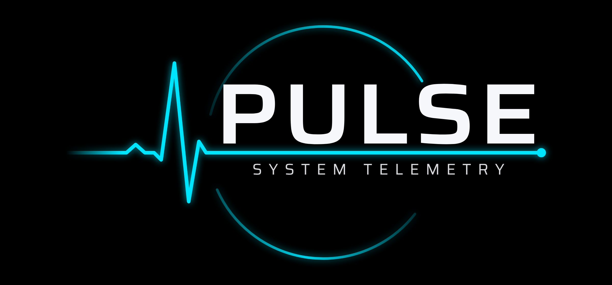
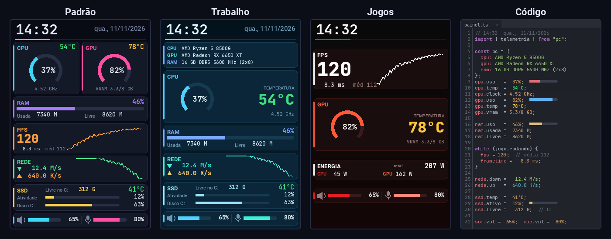
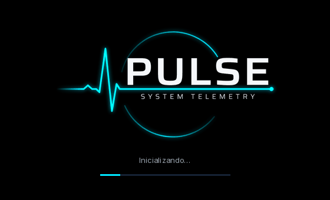
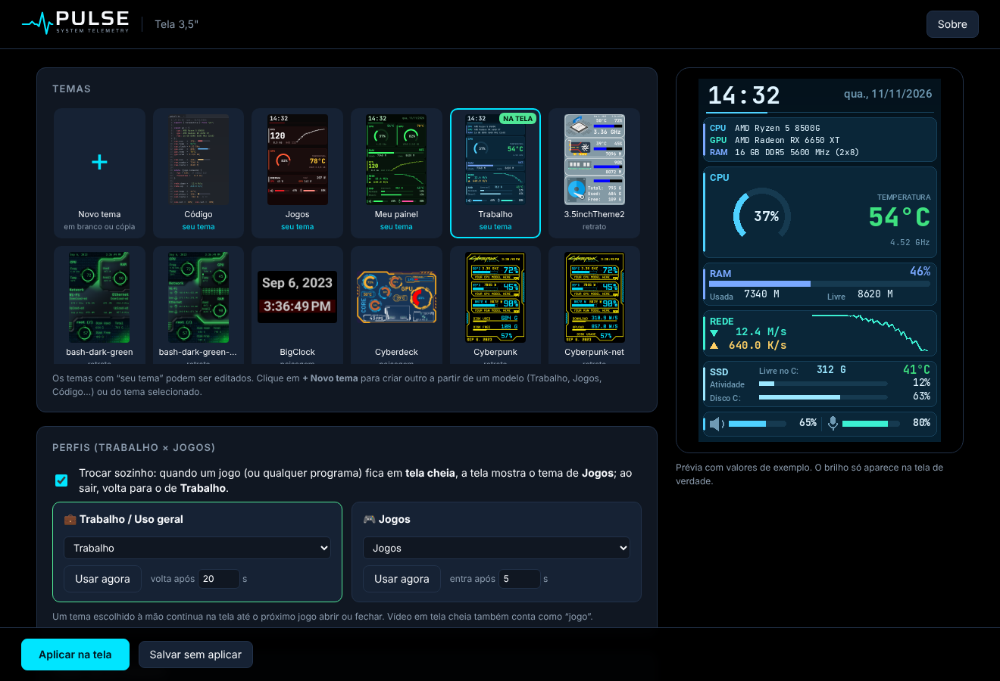

<p align="center">
  
</p>

<h1 align="center">PULSE — System Telemetry</h1>

<p align="center">
  Monitoramento e telemetria de hardware em tempo real na tela USB de 3,5" (Turing Smart Screen / TURZX) no Windows,<br>
  feito para substituir o TURMO. Tem temas próprios, perfis Trabalho e Jogos, ícone na bandeja e instalador.<br>
  <sub>Até a versão 6.1 se chamava "Painel de Telemetria".</sub>
</p>

<p align="center">
  
</p>

## O que ele mostra

- **CPU e GPU**: uso, temperatura com **cor dinâmica** (verde abaixo de 70 °C, amarelo até 85 °C e vermelho acima, com limites ajustáveis), clock, VRAM e consumo em **watts**
- **Nome e modelo** da CPU, da GPU e da RAM (ex.: `16 GB DDR5 5600 MHz (2x8)`)
- **RAM** usada e livre
- **FPS, frametime e média de FPS da sessão** durante jogos
- **Rede**: download e upload, com gráfico
- **SSD**: temperatura, atividade, uso e espaço livre do C:
- **Áudio** dividido ao meio: volume do alto-falante e do microfone
- **Data e hora**

## Recursos

- **Tela de inicialização animada**: ao abrir o PULSE, o logo "respira" enquanto a janela carrega, com a barra de progresso seguindo as etapas reais.
- **Janela de configuração própria** (sem navegador): escolha o tema, ligue/desligue e reordene as informações, mude cores, fontes, estilo dos cartões, fundo e brilho, com prévia ao vivo.
- **Crie quantos temas quiser**, a partir de quatro modelos: Padrão, Trabalho / Produtividade, Jogos e **Código** (a tela parece um editor de programação). Os 38 temas de 3,5" da comunidade também estão incluídos.
- **Troca de tema na hora**, como no TURMO: o programa da tela continua aberto e só redesenha (girar a tela 180° ainda reinicia).
- **Perfis automáticos**: quando um jogo fica em tela cheia, a tela troca para o tema de Jogos e volta para o de Trabalho quando você sai.
- **Ícone na bandeja** do Windows: abre a configuração, troca o perfil, muda o brilho, reinicia ou desliga a tela.
- **Tela Sobre** com a versão instalada, o desenvolvedor, o repositório e os créditos.
- **Inicia com o Windows** e reabre sozinho se o programa da tela fechar.

<p align="center">
  
</p>

<p align="center">
  
</p>

## Instalação

1. Baixe o **`PULSE-Setup.exe`** na página de [Releases](../../releases/latest).
2. Dê dois cliques e aceite o pedido de administrador. Como o instalador não tem assinatura digital, o Windows pode mostrar "O Windows protegeu o computador": clique em **Mais informações** e depois em **Executar assim mesmo**.
3. Pronto: a tela começa a ser atualizada. Para configurar, clique no ícone do PULSE perto do relógio (na setinha ^) ou no atalho **PULSE** da Área de Trabalho.

Quem já tem o Painel de Telemetria (versão 6 ou anterior) só precisa rodar o `PULSE-Setup.exe`: ele atualiza a instalação e mantém temas, perfis e configurações.

A instalação precisa de internet para baixar os componentes do Python (cerca de 60 MB). Se o PC não tiver Python 3.10 a 3.13, o instalador baixa o Python 3.12.

Para desinstalar, use **Configurações > Aplicativos > PULSE — System Telemetry**. Ele pergunta se você quer manter seus temas.

### Requisitos

| | |
|---|---|
| Sistema | Windows 10 ou 11, 64 bits |
| Tela | Turing Smart Screen 3,5" (USB `VID_1A86 PID_5722`, revisão A) e compatíveis com o [turing-smart-screen-python](https://github.com/mathoudebine/turing-smart-screen-python) |
| Sensores | LibreHardwareMonitor (incluído); por isso o painel roda como administrador |
| Janela | WebView2 do Windows (já vem no Windows 10/11 atualizado) |

Testado com Ryzen 5 8500G e Radeon RX 6650 XT. O FPS vem do driver AMD pelo LibreHardwareMonitor e aparece como `--` fora de jogos ou em placas que não fornecem esse sensor. Os watts aparecem como `--` quando o hardware não tem esse sensor.

## Como funciona

O painel usa o **[turing-smart-screen-python](https://github.com/mathoudebine/turing-smart-screen-python)** (versão 3.10.0) para desenhar na tela e o **LibreHardwareMonitor** para ler os sensores. Este repositório adiciona:

| Pasta / arquivo | O que faz |
|---|---|
| `painel/gerador.py` | Transforma as escolhas de um tema (`C:\PainelTelemetria\temas\*.json`) em um tema do turing-smart-screen-python (`background.png` + `theme.yaml`) e desenha a prévia |
| `painel/config_ui.py` + `painel/ui.html` | Janela de configuração (pywebview + WebView2), servida em `127.0.0.1:5680`, com a tela Sobre |
| `painel/splash.py` | Tela de inicialização (Tkinter): logo animado e progresso real recebido em `127.0.0.1:5683`; fecha sozinha se o carregamento falhar |
| `painel/iniciar.py` | Ícone da bandeja, perfis automáticos por tela cheia e vigia que mantém a tela rodando; recebe comandos em `127.0.0.1:5681` |
| `painel/troca_tema.py` | Roda dentro do programa da tela e troca tema e brilho sem reiniciar; recebe comandos em `127.0.0.1:5682` |
| `painel/tela_usb.py` | Roda dentro do programa da tela e cuida da porta COM: acha a tela pela VID/PID em qualquer COM, espera se ela não está ligada ou se a porta está ocupada, reconecta depois do reset ou de uma queda e grava o estado em `tela.json` |
| `painel/abrir.py` | Alvo do atalho "PULSE": mostra a splash e pede a janela ao iniciador |
| `painel/parar_painel.py` | Encerra os processos do painel (usado pelo instalador) |
| `sensores/sensors_custom.py` | Sensores extras: temperaturas com cor dinâmica, watts, VRAM, FPS/frametime e média da sessão, volume do alto-falante e do microfone, SSD, nomes do hardware |
| `instalador/` | `instalar.ps1` (Python, dependências, tarefa de inicialização, atalhos), `desinstalar.ps1`, `setup.nsi` (instalador NSIS) e pacotes Python prontos em `wheels/` |
| `scripts/montar_pacote.py` | Baixa o turing-smart-screen-python, junta com este código e gera o `.zip` e o `Setup.exe` |
| `marca/` | Identidade visual: logo em SVG e PNG (fundo preto e transparente), símbolo, ícone `.ico` e ícone da bandeja |
| `scripts/marca/` | Gera os SVGs da marca (texto convertido em curvas) e converte para PNG |

Depois de instalado, tudo fica em `C:\PainelTelemetria`:

```
C:\PainelTelemetria
├── app\              programa (turing-smart-screen-python + pasta painel)
├── temas\            seus temas (*.json), mantidos ao reinstalar
├── fundos\           imagens de fundo enviadas pela configuração
├── perfis.json       temas dos perfis Trabalho e Jogos
├── tela.json         estado da conexão com a tela USB (porta, conectada, ocupada...)
├── iniciar.log       registro de trocas de perfil, reinícios e por que a tela parou
└── main_saida.log    erros do programa da tela que não chegam ao app\log.log
```

### A tela não mostra nada

A janela de configuração mostra o estado da tela USB embaixo da prévia. O `app\log.log` tem cada etapa da conexão em português:

| No log | O que fazer |
|---|---|
| `Nenhuma porta COM com VID 1A86 / PID 5722` | A tela não aparece no Windows: troque de entrada USB ou de cabo e confira em Gerenciador de Dispositivos > Portas (COM e LPT) |
| `A porta COMx existe, mas outro programa está usando` | Feche o TURMO ou outro programa da tela; o PULSE conecta sozinho quando a porta for liberada |
| `Encontradas 2 telas compatíveis` | Mostra qual porta foi usada e por quê; para fixar uma, ponha `COM_PORT: "COMx"` no `app\config.yaml` |
| `Falha na comunicação com a tela` / `Tentando reconectar` | A tela caiu durante o uso; o programa da tela reabre e redesenha sozinho |
| `Imagem enviada com sucesso` | A conexão está boa |

## Gerar o instalador

Precisa de Python 3, Git e [NSIS](https://nsis.sourceforge.io) (`apt install nsis` no Linux ou `choco install nsis` no Windows).

```bash
python scripts/montar_pacote.py              # gera dist/PULSE-<versão>.zip e dist/PULSE-Setup.exe
python scripts/montar_pacote.py --sem-setup  # só o .zip (instalação manual pelo Instalar.bat)
```

Para publicar uma versão nova: aba **Actions** > **Gerar instalador** > **Run workflow**, preencha a versão (por exemplo `v7.0`) e confirme. O GitHub gera o instalador e cria a Release com ele. Também funciona criando uma Release pelo site com uma tag nova.

Para testar sem a tela, instale com `Instalar (simulador).bat` do pacote .zip e abra `http://localhost:5678`.

## Créditos e licença

- [turing-smart-screen-python](https://github.com/mathoudebine/turing-smart-screen-python), de Matthieu Houdebine e colaboradores (GPL-3.0)
- [LibreHardwareMonitor](https://github.com/LibreHardwareMonitor/LibreHardwareMonitor) (MPL-2.0)
- [pywebview](https://github.com/r0x0r/pywebview), [pystray](https://github.com/moses-palmer/pystray) e [pycaw](https://github.com/AndreMiras/pycaw)
- Fonte [Saira](https://fonts.google.com/specimen/Saira) no logotipo (SIL Open Font License 1.1)

Desenvolvido por Deivid Robinson.

Como usa e distribui o turing-smart-screen-python, este projeto também é licenciado sob a **GNU GPL-3.0**. Veja o arquivo [LICENSE](LICENSE).

Este projeto não tem relação com o fabricante da tela nem com o TURMO.
